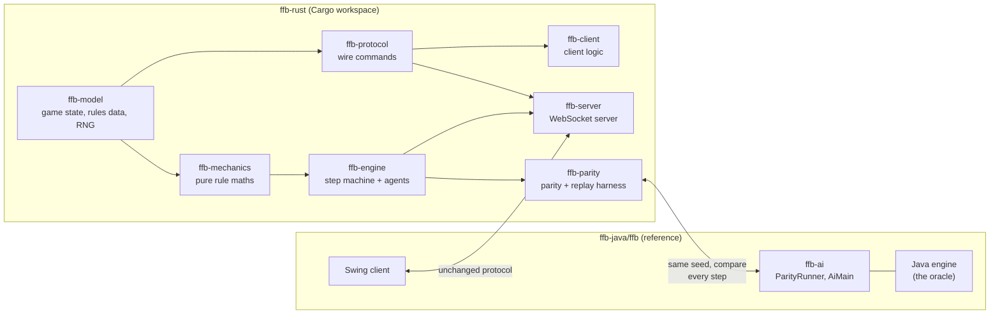

# FFB-Rust

**A Rust port of [FUMBBL](https://fumbbl.com)'s Blood Bowl engine, proven to play exactly like the original.**

FFB-Rust is a file-for-file, method-for-method translation of the Java *Fantasy Football* (FFB)
engine into Rust. It covers all three rule editions: BB2016, BB2020 and BB2025. It is not an
approximation. Every game is replayed through both engines and compared after every step: the
same dice, the same decisions, the same state, the same game log and the same client view.

The unmodified Java Swing client can connect to the Rust server and play a full game on it.



## Quick start

Requirements: Rust (stable), Java 17+ and Maven (only for the Java side).

```bash
cd ffb-rust
cargo build --release
cargo test --workspace
```

### Run a parity check against Java

```bash
# build the Java oracle + harness once
cd ffb-java/ffb && mvn -o -q -DskipTests package && cd ../../ffb-rust

# lineman regression gate (no arguments)
./target/release/ffb-parity

# a chosen matchup, edition and seed range
./target/release/ffb-parity --home human --away orc --edition bb2020 --tier 3 \
    --agent heuristic --seeds 1-20
```

Each run prints `PARITY: n/n games match` and `REPORTS: n/n games identical`. The first differing
step is reported with both engines' hashes. The full method is in
[docs/PARITY_PROCESS.md](ffb-rust/docs/PARITY_PROCESS.md).

### Re-simulate FUMBBL replays

```bash
cargo build --release -p ffb-parity --bin ffb-replay
python -I scripts/replay_parity_check.py
```

### Play with the Java GUI on the Rust server

```bash
cargo build -p ffb-server
# the server must run from the Java server tree (it loads teams/, rosters/, setups/)
cd ../ffb-java/ffb/ffb-server
../../../ffb-rust/target/debug/ffb-server 127.0.0.1:22227
```

Then start the Swing client (`com.fumbbl.ffb.client.FantasyFootballClientAwt -player -coach Kalimar
-server localhost -port 22227`) or the headless `AiMain` agent, and create a game. No database is
needed. `python -I scripts/gui_check.py --games 3` plays whole AI-vs-AI games through the server.

## Parity

The Java engine is the oracle. Each test game is played twice, once by each engine:

- **Same inputs.** Both engines share one seeded dice stream (Xoshiro256**), the same teams and the
  same options. Matching agents (Rust in `ffb-engine`, Java in `ParityRunner`) make every decision
  from the same state with the same rules, so any difference comes from the engine itself.
- **Compared every step.** After each decision the harness compares the state hash (players,
  ball, turn data, flags, results; see [PARITY_STATE_HASH.md](ffb-rust/docs/PARITY_STATE_HASH.md))
  and the dice-call count; the report stream and the client view (what the GUI shows, at each
  activation) are compared too. One mismatch anywhere fails the game, even if the final state
  converges.
- **No silent passes.** A game that aborts, stalls or loops counts as a failure. A crash in stock
  Java is reported separately as JAVA-CRASH and must be documented in
  [JAVA_DEFECTS.md](ffb-rust/docs/JAVA_DEFECTS.md).
- **Suites.** Mirror (every roster against itself), cross (roster against roster), star players and
  skill squads, in all three editions and at three heuristic-agent scales (0, 1 and 10⁶). A
  certification runs every suite on one frozen Rust binary and Java harness jar.
- **Real games.** FUMBBL replays are re-simulated, and every recorded state must come out identical.
- **Fixing a difference.** Rust is changed to match Java line for line, never the reverse. A genuine
  Java bug is still ported as the default, with the fix behind a flag, so the two engines stay
  comparable.

| Check | Result |
| --- | --- |
| Mirror matches: every roster against itself, 3 editions | **330 / 330** identical |
| Cross matches: roster against roster, 3 editions | **4,012 / 4,012** identical |
| Star-player matches | **4,012 / 4,012** identical |
| Skill squads: every skill each edition resolves | **121 / 121** squads, **411 / 411** skills fired |
| Real games: FUMBBL replays re-simulated | **2,224 / 2,224** identical (1.14 M records) |
| Client view: what the GUI shows, step by step | identical on every suite above |
| Java GUI client on the Rust server | plays whole games |
| Unit tests | 15,000+ passing |

See [docs/HISTORY.md](ffb-rust/docs/HISTORY.md) for how each number was reached.

## Java defects

Parity work turns up bugs in stock Java, where it does something no reading of the rules supports.
Rust reproduces each one by default so the engines stay comparable, and where a fix exists it sits
behind a flag on `Game::defect_fixes`. Each one is confirmed by a unit test that drives stock Java
into it (`ffb-ai/.../defects/JavaDefectsTest.java`). Details, evidence, the Rust side of each and the
suspects that turned out not to be defects are in [JAVA_DEFECTS.md](ffb-rust/docs/JAVA_DEFECTS.md).

| ID | Edition | Defect | Rust fix flag |
| --- | --- | --- | --- |
| JD-001 | 2025 | `StepPuntDistance` sets `outOfBounds` when the punt leaves the pitch but never clears it, so when a re-rolled distance lands the ball on the pitch it still publishes a throw-in from that interior square, and `ThrowInMechanic` throws `IllegalStateException` because an interior square has no throw-in direction. | yes |
| JD-002 | all | The referee's armour-doubles check (the `StepReferee` hook in `SneakyGitBehaviour`, run for every foul) reads `armorRoll[0]` without a null check, but a fouled Ball & Chain player's armour is broken with no armour roll, so the step throws `NullPointerException`. | yes |
| JD-004 | 2020 | bb2020 `StepJump` has no `usingDivingTackle` guard (bb2025's has one), so when the opposing coach answers the Diving Tackle question after a team-re-rolled leap has succeeded, `executeStep` runs again and spends the team re-roll a second time, taking the bank below zero. | not yet |
| JD-005 | 2025 | bb2025 `StepMoveDodge` still has DODGE as its re-rolled action when the opposing coach answers the Arm Bar choice (two or more Arm Bar players), so `executeStep` spends the team re-roll a second time and rolls a third dodge die, which can turn the twice-failed dodge into a success. | not yet |
| JD-006 | 2020, 2025 | `StepInitFuriousOutburst` jumps to the end of the sequence without setting a target selection when the coach ends the turn at the target prompt, and `StepEndFuriousOutburst` dereferences that missing target selection, throwing `NullPointerException` (Rust does not reproduce the crash yet). | not yet |
| JD-007 | 2020, 2025 | When a skill re-rolls a failed armour roll (e.g. bb2025 Master Assassin on a Stab), eleven injury types finish with the context-less `setInjury`, which works on the original injury context instead of the re-rolled one, so Java rolls a needless casualty for the original (whose armour held) and never turns the re-rolled injury into a result, leaving the victim unhurt. | not yet |
| JD-008 | 2025 | When a Pitch Invasion picks a Ball & Chain player, `UtilServerInjury.dropPlayer` rolls the chain injury and only publishes it as `INJURY_RESULT` instead of changing the player's state, and the bb2025 kick-off sequence has no apothecary step to apply it, so the Fanatic is reported stunned but stays standing. | not yet |

Not every oddity is a defect. The bb2016 card deck is kept in JVM hash order (PQ-001, formerly JD-003),
which is legal under the rules but means Java cannot replay its own card draws.

## Repository layout

| Path | What it holds |
| --- | --- |
| `ffb-rust/crates/` | The seven Rust crates in the diagram above |
| `ffb-rust/data/` | Rosters, teams, skills, inducements, injuries, prayers, cards, star players |
| `ffb-rust/scripts/` | Suite runners, team drafting, roster audits, replay tools |
| `ffb-rust/rules/` | The BB2025 rulebook and star players as Markdown |
| `ffb-rust/docs/` | Method, backlog, milestones, history |
| `ffb-rust/ml/` | Behaviour-cloning experiments on the engine |
| `ffb-java/ffb/` | The Java engine (reference) and the parity harness (`ffb-ai`) |

## Documentation

- [HISTORY.md](ffb-rust/docs/HISTORY.md): the project timeline and what each milestone took.
- [PARITY_PROCESS.md](ffb-rust/docs/PARITY_PROCESS.md): how parity is measured and debugged.
- [PARITY_STATE_HASH.md](ffb-rust/docs/PARITY_STATE_HASH.md): what the per-step hash covers.
- [MILESTONE_SKILL_COVERAGE.md](ffb-rust/docs/MILESTONE_SKILL_COVERAGE.md): the latest certification.
- [JAVA_DEFECTS.md](ffb-rust/docs/JAVA_DEFECTS.md): Java bugs found along the way.
- [MCTS_SEARCH_SPEC.md](ffb-rust/docs/MCTS_SEARCH_SPEC.md): the plan for tree search on the engine.
- [BACKLOG.md](ffb-rust/docs/BACKLOG.md): the working log and queue.

## License

The Rust code is MIT licensed; see [LICENSE](LICENSE). The Java engine in `ffb-java/ffb/` is
MIT licensed by Christer Kaivo-oja; see [ffb-java/ffb/LICENSE](ffb-java/ffb/LICENSE). Blood Bowl is
a trademark of Games Workshop; this project is not affiliated with it.
