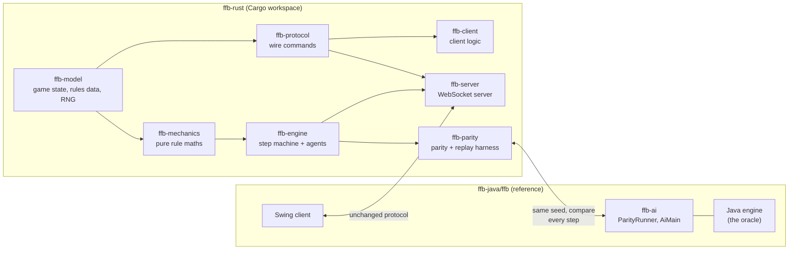

# FFB-Rust

**A Rust port of [FUMBBL](https://fumbbl.com)'s Blood Bowl engine, proven to play exactly like the original.**

FFB-Rust is a file-for-file, method-for-method translation of the Java *Fantasy Football* (FFB)
engine into Rust. It covers all three rule editions: BB2016, BB2020 and BB2025. It is not an
approximation. Every game is replayed through both engines and compared after every step: the
same dice, the same decisions, the same state, the same game log and the same client view.

The unmodified Java Swing client can connect to the Rust server and play a full game on it.

## Status

| Check | Result |
| --- | --- |
| Mirror matches: every roster against itself, 3 editions | **330 / 330** identical |
| Cross matches: roster against roster, 3 editions | **4,012 / 4,012** identical |
| Star-player matches | **4,012 / 4,012** identical |
| Skill squads: every skill each edition resolves | **121 / 121** squads, **411 / 411** skills fired |
| Real games: FUMBBL replays re-simulated | **2,224 / 2,224** identical (1.14 M records) |
| Client view: what the GUI shows, step by step | identical on every suite above |
| Java GUI client on the Rust server | plays whole games |
| Unit tests | 15,000+ passing |

"Identical" means per-step state hash, dice-call count, report stream and client-view JSON all
match the Java engine for every step of every game. See [docs/HISTORY.md](ffb-rust/docs/HISTORY.md)
for how each number was reached.

## How it fits together



## Quick start

Requirements: Rust (stable), Java 17+ and Maven (only for the Java side).

```bash
cd ffb-rust
cargo build --release
cargo test --workspace
```

### Run a parity check against Java

```bash
# build the Java oracle + harness once
cd ffb-java/ffb && mvn -o -q -DskipTests package && cd ../../ffb-rust

# lineman regression gate (no arguments)
./target/release/ffb-parity

# a chosen matchup, edition and seed range
./target/release/ffb-parity --home human --away orc --edition bb2020 --tier 3 \
    --agent heuristic --seeds 1-20
```

Each run prints `PARITY: n/n games match` and `REPORTS: n/n games identical`. The first differing
step is reported with both engines' hashes. The full method is in
[docs/PARITY_PROCESS.md](ffb-rust/docs/PARITY_PROCESS.md).

### Re-simulate FUMBBL replays

```bash
cargo build --release -p ffb-parity --bin ffb-replay
python -I scripts/replay_parity_check.py
```

### Play with the Java GUI on the Rust server

```bash
cargo build -p ffb-server
# the server must run from the Java server tree (it loads teams/, rosters/, setups/)
cd ../ffb-java/ffb/ffb-server
../../../ffb-rust/target/debug/ffb-server 127.0.0.1:22227
```

Then start the Swing client (`com.fumbbl.ffb.client.FantasyFootballClientAwt -player -coach Kalimar
-server localhost -port 22227`) or the headless `AiMain` agent, and create a game. No database is
needed. `python -I scripts/gui_check.py --games 3` plays whole AI-vs-AI games through the server.

## Repository layout

| Path | What it holds |
| --- | --- |
| `ffb-rust/crates/` | The seven Rust crates in the diagram above |
| `ffb-rust/data/` | Rosters, teams, skills, inducements, injuries, prayers, cards, star players |
| `ffb-rust/scripts/` | Suite runners, team drafting, roster audits, replay tools |
| `ffb-rust/rules/` | The BB2025 rulebook and star players as Markdown |
| `ffb-rust/docs/` | Method, backlog, milestones, history |
| `ffb-rust/ml/` | Behaviour-cloning experiments on the engine |
| `ffb-java/ffb/` | The Java engine (reference) and the parity harness (`ffb-ai`) |

## Documentation

- [HISTORY.md](ffb-rust/docs/HISTORY.md): the project timeline and what each milestone took.
- [PARITY_PROCESS.md](ffb-rust/docs/PARITY_PROCESS.md): how parity is measured and debugged.
- [PARITY_STATE_HASH.md](ffb-rust/docs/PARITY_STATE_HASH.md): what the per-step hash covers.
- [MILESTONE_SKILL_COVERAGE.md](ffb-rust/docs/MILESTONE_SKILL_COVERAGE.md): the latest certification.
- [JAVA_DEFECTS.md](ffb-rust/docs/JAVA_DEFECTS.md): Java bugs found along the way.
- [MCTS_SEARCH_SPEC.md](ffb-rust/docs/MCTS_SEARCH_SPEC.md): the plan for tree search on the engine.
- [BACKLOG.md](ffb-rust/docs/BACKLOG.md): the working log and queue.

## License

The Rust code is MIT licensed; see [LICENSE](LICENSE). The Java engine in `ffb-java/ffb/` is
MIT licensed by Christer Kaivo-oja; see [ffb-java/ffb/LICENSE](ffb-java/ffb/LICENSE). Blood Bowl is
a trademark of Games Workshop; this project is not affiliated with it.
